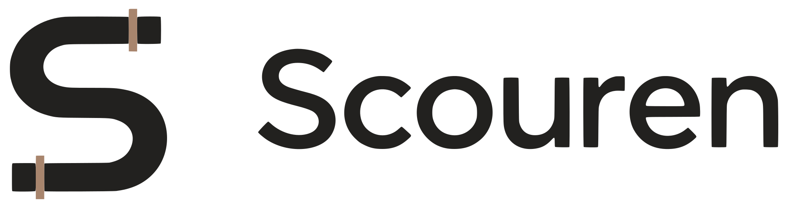
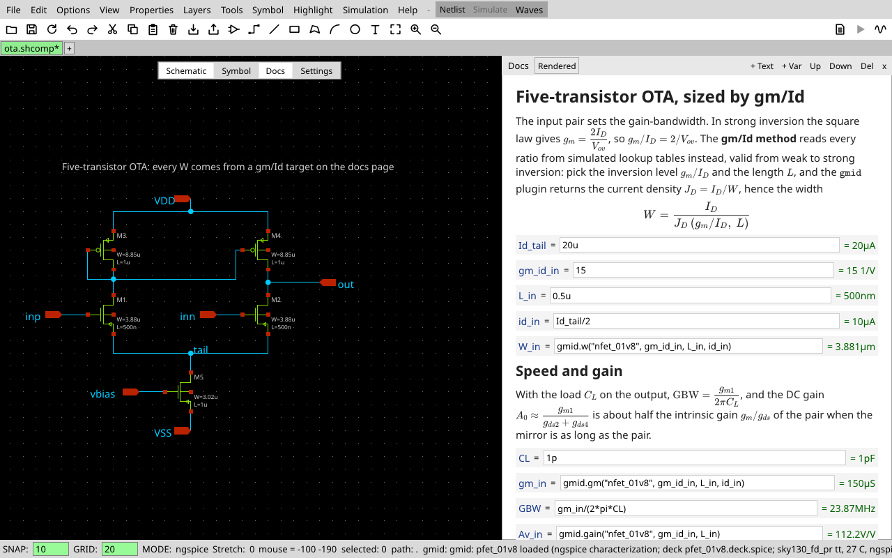
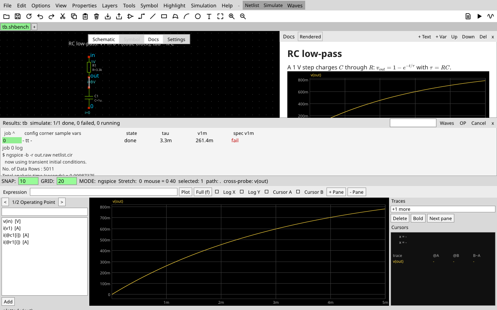
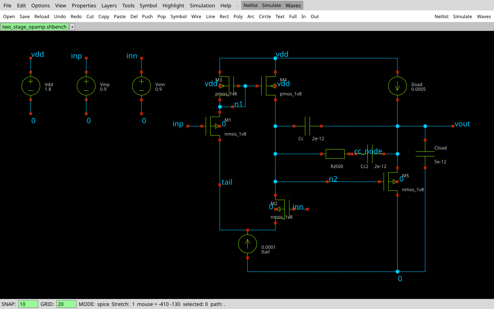
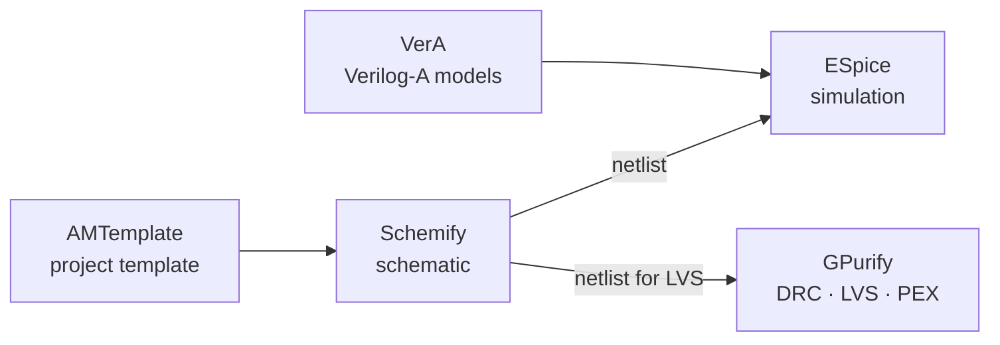
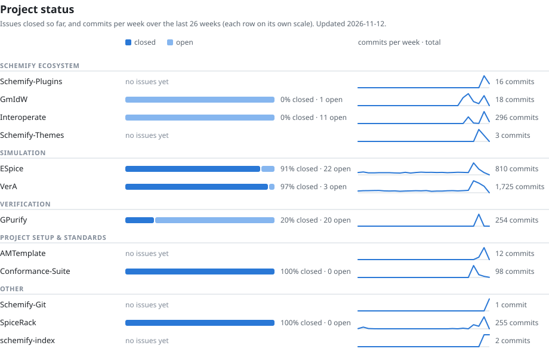

<p align="center">
  <picture>
    <source media="(prefers-color-scheme: dark)" srcset="logo-dark.svg">
    
  </picture>
</p>

<p align="center">
  Analog and mixed-signal IC design tools, from schematic to sign-off.<br>
  <a href="https://scouren.com"><b>scouren.com</b></a> ·
  <a href="https://github.com/Scouren/Schemify-Releases/releases/latest">Download Schemify</a> ·
  <a href="#open-source">Open source</a>
</p>

## Schemify

**Schemify is our schematic editor for analog and mixed-signal IC design.** It's a fast, lightweight replacement for xschem, written in Rust. It draws schematics, writes netlists for ESpice, ngspice, Xyce, LTspice, HSPICE, CDL, Spectre and Verilog, runs the simulation and shows the waveforms. It imports xschem libraries and PDKs, so you can switch without redrawing anything.

<p align="center">
  
</p>

- **Docs next to the circuit.** Each cell carries a docs page with Markdown, LaTeX and live gm/Id sizing math that updates the schematic when a value changes.
- **Plain-text designs.** One line per object, so a change is a one-line diff, and `schemify merge-driver` merges branches object by object.
- **Safe to open.** Opening a file never runs anything. Simulator commands live in your own config and in plugins.
- **A small core with plugins, like Neovim.** Plugins are sandboxed wasm with the permissions you grant. Even the xschem-style menus are a plugin you can replace.
- **The same netlist everywhere.** Byte-identical output on Linux, macOS, Windows and WASI, with xschem's default keys.

| | |
|---|---|
|  |  |
| Simulate, then read results, specs and waveforms | A SPICE netlist turned into a schematic |

### Install

```sh
brew install scouren/schemify/schemify          # macOS and Linux
nix run github:Scouren/Schemify-Releases        # Nix and NixOS
```

There are also `.deb`, `.rpm`, Arch and Windows builds on the [releases page](https://github.com/Scouren/Schemify-Releases/releases/latest) and at [scouren.com](https://scouren.com). To build plugins and themes, start with the [Schemify plugin SDK](https://github.com/Scouren/Schemify-Plugins).

## Open source

Schemify is built on open tools that also work on their own beside the ones you already use: SPICE simulation in **ESpice**, Verilog-A device models compiled by **VerA**, and DRC, LVS, ERC and PEX in **GPurify**.



```sh
nix run github:Scouren/ESpice -- deck.sp        # simulate a SPICE deck
```

To start a chip or block, create a repository from [AMTemplate](https://github.com/Scouren/AMTemplate) (**Use this template**), then run `make -C .flows CreateProject PROJECT_NAME=my_chip PROJECT_TYPE=mixed`.

These tools are young and move quickly. The chart shows how much of each project's tracked work is done and how active it has been lately. A daily job updates it.

<!-- status:start -->
<picture>
  <source media="(prefers-color-scheme: dark)" srcset="status-dark.svg">
  
</picture>

| Group | Project | What it does | Status |
|---|---|---|---|
| Schemify ecosystem | [Schemify-Plugins](https://github.com/Scouren/Schemify-Plugins) | Schemify SDK: file format, plugin ABI, SDKs and sandbox host for building Schemify plugins and themes | [](https://github.com/Scouren/Schemify-Plugins/actions/workflows/ci.yml)  |
| Schemify ecosystem | [GmIdW](https://github.com/Scouren/GmIdW) | Gm&IdW: gm/Id design visualizer (Schemify plugin) | [](https://github.com/Scouren/GmIdW/actions/workflows/ci.yml)  |
| Schemify ecosystem | [Interoperate](https://github.com/Scouren/Interoperate) | Schemify's Import/Export working with other Schematic Editors so you can use it interchangeably | [](https://github.com/Scouren/Interoperate/actions/workflows/ci.yml)  |
| Schemify ecosystem | [Schemify-Themes](https://github.com/Scouren/Schemify-Themes) | spicetify's theme catalogue for Schemify: 16 themes, 115 colour schemes, View → Themes | [](https://github.com/Scouren/Schemify-Themes/actions/workflows/gate.yaml)  |
| Simulation | [ESpice](https://github.com/Scouren/ESpice) | Fast Spice Simulations, with Verilog-AMS support using VerA | [](https://github.com/Scouren/ESpice/actions/workflows/test.yml)  |
| Simulation | [VerA](https://github.com/Scouren/VerA) | A Verilog-AMS Compiler with SIMD and GPU support as first-class residents | [](https://github.com/Scouren/VerA/actions/workflows/test.yaml) [](https://github.com/Scouren/VerA/releases/latest)  |
| Verification | [GPurify](https://github.com/Scouren/GPurify) | A SIMD-First DRC, ERC, LVS, PEX engine, built for better checks than propietary work | [](https://github.com/Scouren/GPurify/actions/workflows/test.yml)  |
| Project setup & standards | [AMTemplate](https://github.com/Scouren/AMTemplate) | Template for analog and mixed-signal ASIC design on open-source tools | [](https://github.com/Scouren/AMTemplate/actions/workflows/ci.yaml)  |
| Project setup & standards | [Conformance-Suite](https://github.com/Scouren/Conformance-Suite) | A conformance suite for Verilog-AMS (Containing Verilog-A & IEEE 1364 specifics) | [](https://github.com/Scouren/Conformance-Suite/actions/workflows/conformance.yml)  |
| Other | [Schemify-Git](https://github.com/Scouren/Schemify-Git) | Git version control for Schemify: the Source control pane, status badges, diff and annotate (a Schemify plugin) |  |
| Other | [schemify-index](https://github.com/Scouren/schemify-index) | Schemify plugin and theme marketplace: listings by pull request, reviewed and signed by Scouren |  |
<!-- status:end -->

## Support the open-source tools

The open-source projects are partly community funded. To sponsor the work, or to sponsor by invoice as a company, email [sponsors@scouren.com](mailto:sponsors@scouren.com).
