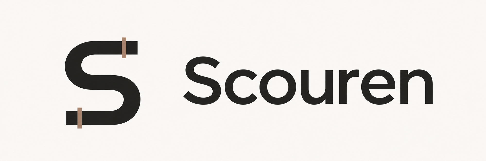
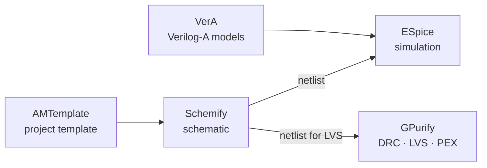

<p align="center"></p>

Scouren builds fast, open analog tooling for analog and mixed-signal IC design, from schematic to sign-off. It automates as much as possible and gives you full control over every tool through plugins.

Scouren covers the steps of an analog design one tool at a time:
- schematic capture in **Schemify**
- SPICE simulation in **ESpice**, with device models written in Verilog-A and compiled by **VerA**
- DRC, LVS, ERC and PEX in **GPurify**

Each tool also works on its own beside the tools you already use. Schemify writes netlists for ngspice, Xyce, LTspice and HSPICE, and its Interoperate plugin moves designs to and from Cadence Virtuoso and xschem.



## Try it

Download Schemify for Linux, macOS or Windows from [scouren.com](https://scouren.com) or the [releases page](https://github.com/Scouren/Schemify-Releases/releases/latest).

These commands need [Nix](https://nixos.org/download/) or a Linux or macOS shell:

```sh
# Simulate a SPICE deck (built from source), or install the release binary
nix run github:Scouren/ESpice -- deck.sp
curl -fsSL https://raw.githubusercontent.com/Scouren/ESpice/main/tools/install.sh | sh
```

To start a whole chip or block, create a repository from [AMTemplate](https://github.com/Scouren/AMTemplate) (**Use this template**), then run `make -C .flows CreateProject PROJECT_NAME=my_chip PROJECT_TYPE=mixed`.

## Projects

These tools are young and move quickly. The chart shows how much of each project's tracked work is done and how active it has been lately. A daily job updates it.

<!-- status:start -->
<picture>
  <source media="(prefers-color-scheme: dark)" srcset="status-dark.svg">
  
</picture>

| Stage | Project | What it does | Status |
|---|---|---|---|
| Start a project | [AMTemplate](https://github.com/Scouren/AMTemplate) | Template for analog and mixed-signal ASIC design on open-source tools | [](https://github.com/Scouren/AMTemplate/actions/workflows/ci.yaml)  |
| Schematic | [Schemify-Releases](https://github.com/Scouren/Schemify-Releases) | Public download binaries for Schemify (Linux, macOS, Windows) | [](https://github.com/Scouren/Schemify-Releases/releases/latest)  |
| Schemify plugins | [Schemify-Plugins](https://github.com/Scouren/Schemify-Plugins) | Schemify SDK: file format, plugin ABI, SDKs and sandbox host for building Schemify plugins and themes | [](https://github.com/Scouren/Schemify-Plugins/actions/workflows/ci.yml)  |
| Schemify plugins | [Interoperate](https://github.com/Scouren/Interoperate) | Schemify's Import/Export working with other Schematic Editors so you can use it interchangeably | [](https://github.com/Scouren/Interoperate/actions/workflows/ci.yml)  |
| Schemify plugins | [GmIdW](https://github.com/Scouren/GmIdW) | Gm&IdW: gm/Id design visualizer (Schemify plugin) | [](https://github.com/Scouren/GmIdW/actions/workflows/ci.yml)  |
| Schemify plugins | [Schemify-Themes](https://github.com/Scouren/Schemify-Themes) | spicetify's theme catalogue for Schemify: 16 themes, 115 colour schemes, View → Themes | [](https://github.com/Scouren/Schemify-Themes/actions/workflows/gate.yaml)  |
| Simulation | [ESpice](https://github.com/Scouren/ESpice) | Fast Spice Simulations, with Verilog-AMS support using VerA | [](https://github.com/Scouren/ESpice/actions/workflows/test.yml)  |
| Simulation | [VerA](https://github.com/Scouren/VerA) | A Verilog-AMS Compiler with SIMD and GPU support as first-class residents | [](https://github.com/Scouren/VerA/actions/workflows/test.yaml) [](https://github.com/Scouren/VerA/releases/latest)  |
| Layout | [GPurify](https://github.com/Scouren/GPurify) | A SIMD-First DRC, ERC, LVS, PEX engine, built for better checks than propietary work | [](https://github.com/Scouren/GPurify/actions/workflows/test.yml)  |
| Suites | [Conformance-Suite](https://github.com/Scouren/Conformance-Suite) | A conformance suite for Verilog-AMS (Containing Verilog-A & IEEE 1364 specifics) | [](https://github.com/Scouren/Conformance-Suite/actions/workflows/conformance.yml)  |
<!-- status:end -->
